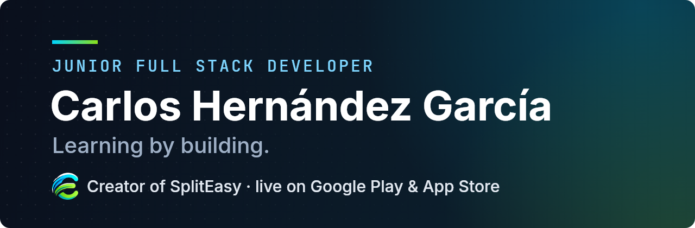

Hi, I'm Carlos, a third-year Computer Engineering student at Universitat Jaume I in Castellón, Spain. I learn by building real projects, from the mobile app to the server behind it.

### SplitEasy

[SplitEasy](https://spliteasy.es) is an app to split shared expenses with friends, on trips or with roommates. I designed and built it myself, and it's live on [Google Play](https://play.google.com/store/apps/details?id=com.spliteasy.app) and the [App Store](https://apps.apple.com/app/id6502877253).

- **App:** React Native with Expo, for Android and iOS
- **Backend:** REST API in PHP with MySQL
- **Sign-in:** Firebase Authentication

The source code is private, but the [SplitEasy repo](https://github.com/carloshg12/SplitEasy) has screenshots, the full feature list and how it's built.

### Also on my GitHub

- **[Revender](https://github.com/carloshg12/Revender-overview):** a system I built with Claude Code that finds the profitable lots in online liquidation auctions. It prices every item with AI and works out the highest bid that still leaves a profit. Python, FastAPI, PostgreSQL, React and the Claude API, in real use on my own server.
- **[Pokedex_Android](https://github.com/carloshg12/Pokedex_Android):** Android app in Kotlin and Jetpack Compose with MVVM, Hilt and Retrofit (PokéAPI) that also works offline.

### Background

- **Full Stack Developer intern** at JC INFORMÀTICS (2024): web and mobile apps with React, React Native and PHP, working directly with clients.
- **Multiplatform App Development (DAM)** at IES El Caminàs, final grade 9.5/10.

### Tech

**Languages:** Java&nbsp;· Python&nbsp;· JavaScript&nbsp;· Kotlin&nbsp;· PHP&nbsp;· SQL 
**Tools:** React&nbsp;· React&nbsp;Native&nbsp;· Expo&nbsp;· Jetpack&nbsp;Compose&nbsp;· MySQL&nbsp;· Firebase&nbsp;· Git&nbsp;· Docker&nbsp;· Linux&nbsp;· Claude&nbsp;Code

### Contact

Open to junior developer roles: remote, or on-site and hybrid in Castellón.

[LinkedIn](https://www.linkedin.com/in/carlos-hernandez-27342924b/) · [carloscharlyhg0@gmail.com](mailto:carloscharlyhg0@gmail.com)
